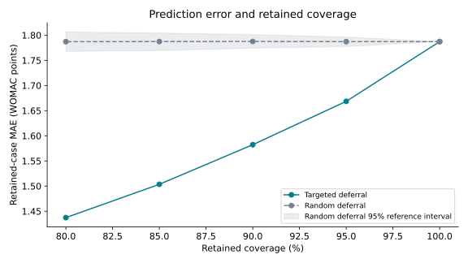

# OAI Knee Pain Prediction Reliability

**Structure–Pain Discordance and 48-Month Knee Pain Prediction Error in the Osteoarthritis Initiative**  
Research by Karthigeyan and Tang • Secondary analysis • Internally validated machine learning

Can the mismatch between knee X-ray severity and reported pain help identify where future pain predictions are less reliable? This project evaluates that question using participant-grouped nested cross-validation in the Osteoarthritis Initiative (OAI).

| Frozen study result | Value |
| --- | --- |
| Baseline cohort | 8,920 knees / 4,490 participants |
| Observed 48-month outcome cohort | 8,232 knees / 4,146 participants |
| Held-out elastic-net MAE | 1.787 WOMAC points |
| Discordance–absolute-error coefficient | 0.301 (95% CI 0.275–0.326) |
| Retained MAE after deferring the highest 10% of uncertainty scores | 1.582 |
| Relative MAE reduction in that retained subset | 11.47% |

These are internally cross-validated results, not external validation or prospective clinical evidence. Deferral changes which cases are evaluated and does not improve predictions for all patients. Discordance quartile means are not monotonically increasing; the coefficient describes the fitted association.



## Interactive companion

[**Open the Model Reliability Explorer**](https://oai-model-reliability.shrewdskink1.chatgpt.site) — adjust fictional X-ray/pain examples, inspect transparent teaching formulas, and explore the actual frozen coverage–error results. The simulator uses synthetic cases and is separate from the fitted OAI models. It is not a clinical prediction service.

## Explore the evidence

- [Research overview and limitations](docs/research_overview.md)
- [Frozen aggregate results](results/tables/frozen_key_results.csv)
- [Analysis code](analysis/) and [original frozen specifications](protocols/)
- [Reproducibility instructions](docs/reproducibility.md)
- [Data access and public/private boundaries](docs/data_policy.md)
- [Source hashes](docs/source_provenance.json) and [release file manifest](PUBLIC_MANIFEST.json)
- [Contributor and assistance documentation](CONTRIBUTORS.md)

## Run without OAI records

Requires Python 3.12. Create a virtual environment and install the public core environment:

```bash
python -m venv .venv
# Linux/macOS:
source .venv/bin/activate
# Windows PowerShell: .venv\Scripts\Activate.ps1
python -m pip install -r requirements.txt
python scripts/reproduce.py --mode public
```

This verifies the public file hashes and rebuilds presentation figures from frozen aggregate tables. It does **not** refit models or reproduce patient-level analysis. Figure styling was created for this public release; numerical source tables remain unchanged.

## Reproduce the analysis with authorized data

Obtain the required OAI source archives independently under the applicable access terms. Do not upload them here. Then run:

```bash
python scripts/reproduce.py --mode full --zip-dir /absolute/path/to/oai-zips
```

The runner rebuilds the cohort, descriptive QC, primary model, an independent repeat of the primary model, the primary hypothesis test, and uncertainty analysis. Optional secondary analyses require `requirements-secondary.txt` and `--secondary`. Local records and all analysis outputs are ignored by Git.

## Status and research integrity

The supplied technical package declares an analysis freeze on **September 13, 2026** and contains an internal protocol lock dated July 21, 2026. This repository was prepared on **October 14, 2026**; it is not proof of a contemporaneously registered preregistration. Journal acceptance, a posted preprint, and outside validation are not claimed here; verified publication links can be added later.

This is a research reproducibility repository, not a patient prediction service or medical advice. There is no deployable, externally validated clinical model in this release. Public packaging preserves the frozen analysis scripts and numerical results. New presentation and orchestration tools are documented separately.

OAI participant records, derived rows, predictions, uncertainty scores, fold assignments, bootstrap draws, and the private technical ZIP are excluded. No redistribution license for OAI data is granted. See [reuse terms](LICENSE.md).
